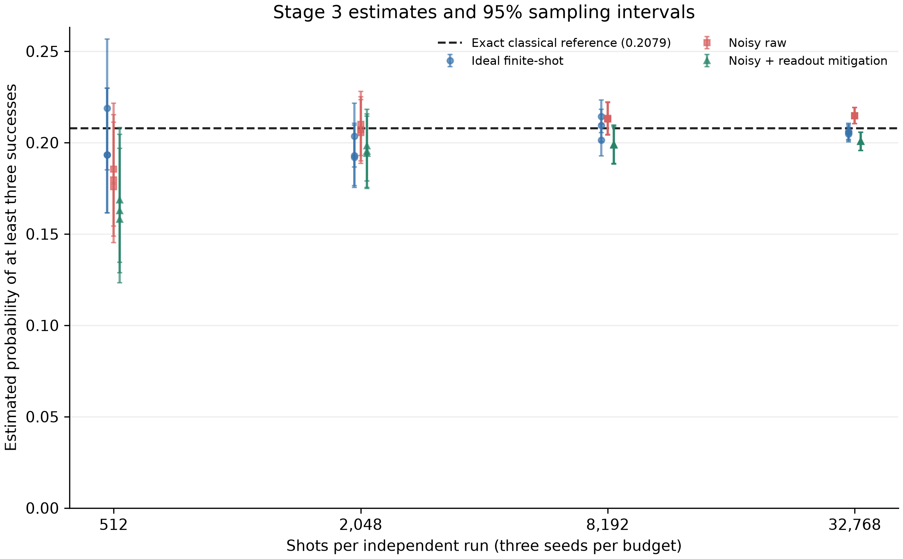
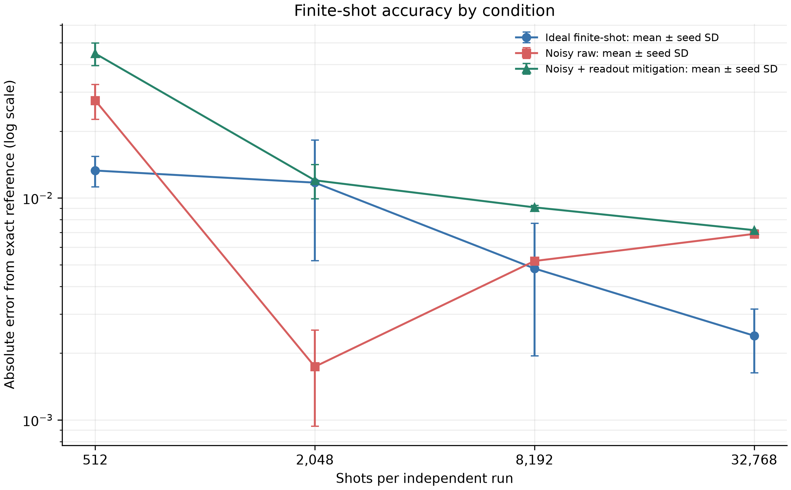

# Final actual challenge results: Stages 1–3

## Stage 1 freeze and inference

The CatBoost native-categorical candidate selected by nested repeated CV was frozen before test-feature inference. Selection used Stage1_Train labels only; the inference loader explicitly requested customer_id and the 15 permitted predictors. Stage1_Test labels were not requested or loaded. Duration and customer_id were excluded as predictors. The selected model's nested outer-CV PR-AUC was 0.2417, ROC-AUC 0.6555, Brier score 0.1012, and log loss 0.3526. These are training validation estimates, not test-set metrics.

The selected model artifact, training-partition digest, model digest, and prediction digest are in `results/stage1_classical/frozen_model.json`. The 100 inference-only scores are in `results/stage1_classical/stage1_test_predictions.csv`.

## Stage 2 exact challenge solution

The ten highest frozen Stage 1 probabilities were joined by customer ID to Stage2_Data. All 210 exact-six subsets were enumerated and independently checked against SciPy MILP. All 210 were feasible, so the constraints are nonbinding over this candidate pool. Both methods selected C0028, C0031, C0079, C0081, C0327, and C0338 with expected net objective 16.1710314161, contact cost 16/25, and capacity 15/22. This is the exact optimum of the stated Stage 2 objective for this top-ten pool; the probability inputs remain model estimates.

Full candidates and selected customer details: `results/stage2_final/actual_top_ten.csv` and `results/stage2_final/actual_selected_six.csv`. Machine-readable independent oracle result: `results/stage2_final/actual_stage2_result.json`.

The same actual ten-candidate pool was also exercised with a real ten-qubit exact-six XY-QAOA circuit. It uses a Dicke state over the 210 six-of-ten strings and an additive objective phase, which is exact on this pool's feasible fixed-six sector because every one of those 210 selections satisfies both resource limits. Four one-seed optimizations compared COBYLA and SPSA with expectation and lower-quartile CVaR objectives at a 10-evaluation cap. None certified convergence. Ideal statevector expected feasible rewards were 10.420–11.400 against the exact classical optimum 16.171; the better SPSA fits sampled the exact optimum with probability about 0.04. With 2,048 Aer shots and the illustrative noisy 10-qubit line, observed feasible rates were about 0.11–0.12 and the exact optimum was not observed in the sampled distributions; conditional feasible rewards were about 8.9–9.0. Readout mitigation changed feasible probability only modestly and did not make the small-budget runs competitive with the exact oracle. Each transpiled circuit used 10 logical/physical simulator qubits, depth 6,010, 7,089 gates, 3,081 two-qubit CX gates, and 981 routing swaps before basis translation. This is an actual circuit/noise stress test, but the optimizer budget is diagnostic and the exact classical answer is authoritative. Full parameters, per-condition metrics, counts, noise assumptions and timing: `results/stage2_final/actual_stage2_qaoa_results.json`.

## Stage 3 probability and circuit results

The independent Poisson-binomial dynamic program and explicit enumeration of all 64 outcome strings both give P(K ≥ 3) = **0.207851597339** for the six selected probabilities. The Qiskit ideal statevector gives 0.207851597339; absolute difference 0. Each qubit is prepared with RY(2 asin √pᵢ), so its success marginal is pᵢ. All six qubits are measured qᵢ→cᵢ. Displayed Qiskit count keys are c5…c0; each qubit's bit is therefore at index 5−i in the string.

The executed circuit uses only single-qubit RY rotations and measurements. Stage 3 therefore has no two-qubit gate errors or connectivity-induced SWAPs. No entangling operations were added. The noise model is illustrative, not hardware calibration: see the result JSON for assumed per-qubit T1/T2, asymmetric readout assignment probabilities, gate durations, single-qubit depolarization, and measurement window.

Readout mitigation estimates per-qubit asymmetric assignment matrices from prepared 0/1 Aer circuits, applies tensor-product matrix inversion, then projects the quasi-distribution to the probability simplex. Raw estimates use Wilson 95% binomial intervals. Mitigated intervals use a multinomial bootstrap through the fixed estimated assignment matrix and projection. They exclude assignment-calibration uncertainty, which is reported separately. Readout mitigation corrects readout assignment errors only; it does not correct RY gate errors or thermal relaxation.

It did **not** consistently reduce absolute error in these experiments. Over three seeds, mean noisy raw estimates at 512/2,048/8,192/32,768 shots were 0.180339/0.207520/0.213053/0.214742; projected mitigated means were 0.163128/0.195841/0.198778/0.200688. Against the exact 0.207852, mitigation was worse at 512 and 2,048 shots; at 8,192 and 32,768 shots it corrected the raw positive bias but slightly increased mean absolute error (raw 0.00520/0.00689; mitigated 0.00907/0.00716). The parametric bootstrap estimated a mitigation-to-raw metric variance ratio of 1.326 on average. This illustrates bias correction with added variance, not a general mitigation benefit. Full per-run estimates, 95% intervals, runtimes, calibration matrices and summaries are in `results/stage3_final/actual_stage3_results.json`.

## Interpretation and scope

The exact classical dynamic program is authoritative for independent Bernoulli trials. The statevector comparison validates the circuit preparation and bit mapping. Finite-shot deviations are sampling error; noisy runs add readout, single-qubit gate, and relaxation effects; differences from the exact value can also include any model error in the Stage 1 probabilities. The local Aer/statevector experiment demonstrates correct probabilistic circuit execution and noise sensitivity, not quantum advantage. A subsequent IBM hardware run of this Stage 3 circuit is separately documented in `reports/ibm_hardware_execution_audit.md`; its raw estimate was 0.201538 over 8,192 shots on `ibm_marrakesh`, and the mitigation effect was inconclusive. The later run does not change the exact classical reference or establish quantum advantage.

The user-provided attached execution brief available in this workspace ends mid-sentence at its graph request (it stops after 'I want publication'); the figures and report here cover all complete requirements preceding that truncation.

Independent final audit: `results/final_actual_independent_audit.json`. It re-enumerates Stage 2, re-solves the MILP, recomputes the four QAOA statevector and finite-shot metrics from persisted parameters/counts, checks Stage 3 DP against all 64 Bernoulli outcomes and the statevector weight histogram, verifies all raw finite-shot rates and Wilson intervals, and confirms the selected six match the Stage 2 optimum. It does not open Stage1_Test or load labels.
